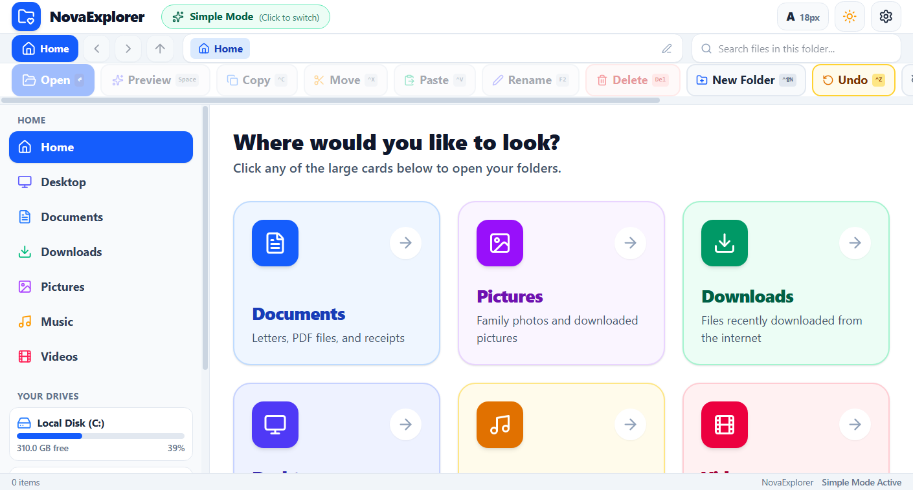
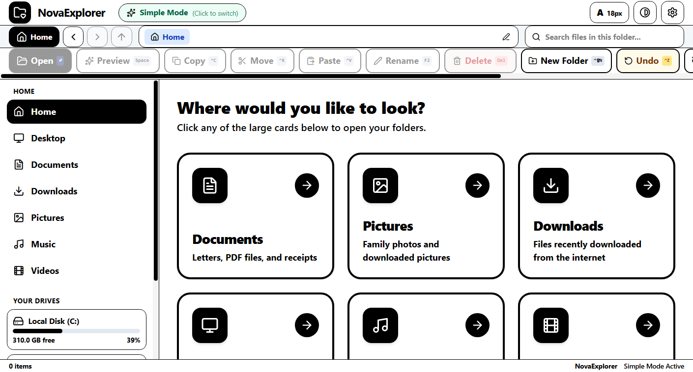
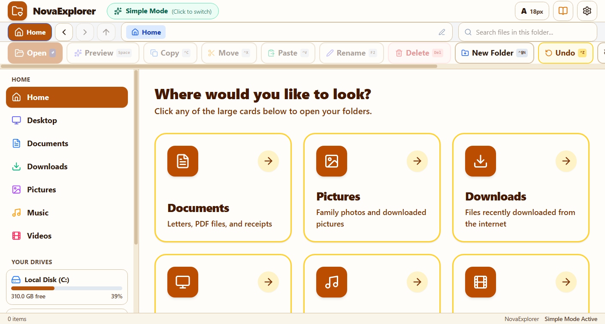
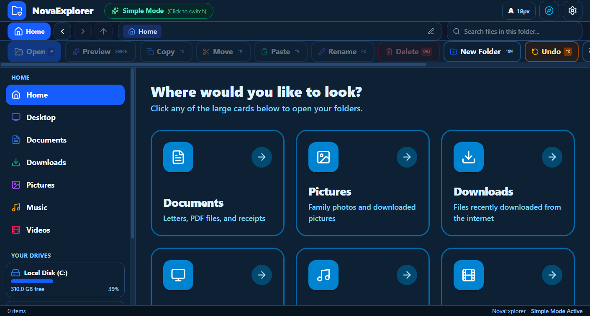
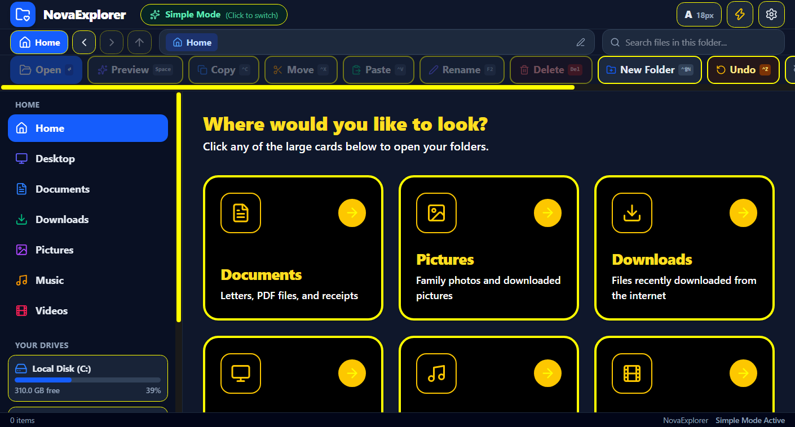
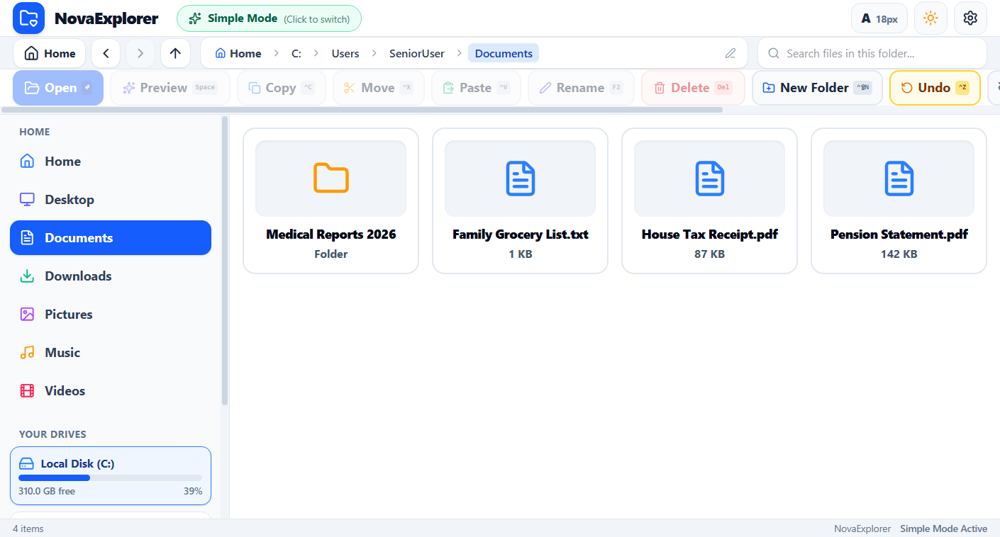
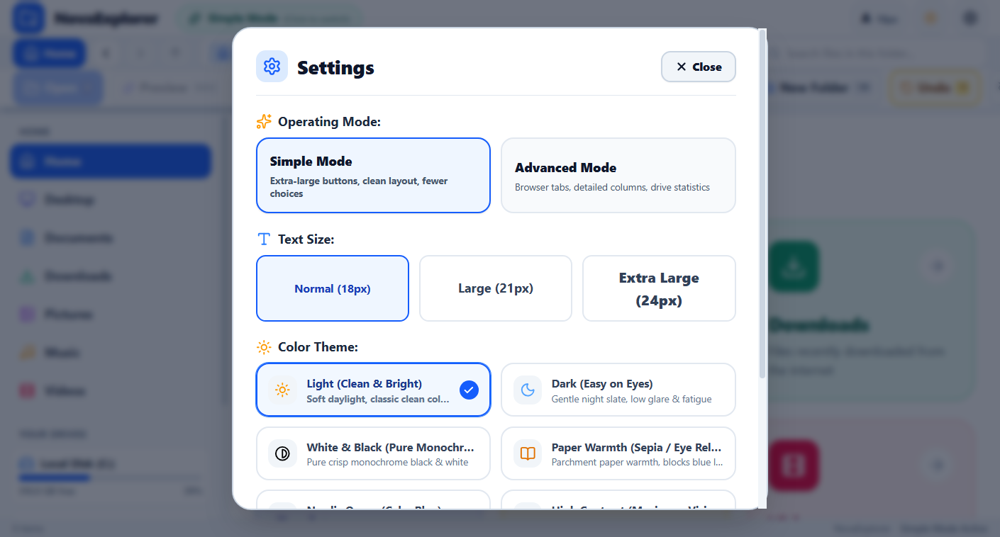

# 🌟 NovaExplorer

> **The accessible, ultra-clear desktop file manager designed for seniors, low-vision users, and everyone who values simplicity and readability.**

Built with **Tauri v2 + Rust + React 19 + Tailwind CSS v4**.

---

## 🎯 Why NovaExplorer?

Modern file managers are cluttered with small 12px fonts, dozens of nested menus, confusing cloud sync states, and complex icon-only toolbars. For elderly individuals, users with low vision, cataracts, or motor impairments, navigating Windows Explorer can be frustrating and overwhelming.

**NovaExplorer** reimagines desktop file management with:
- **Big, High-Contrast Cards**: One-click access to Documents, Pictures, Downloads, Desktop, Music, and Videos.
- **6 Eye-Friendly Color Themes**: Including a specialized Pure Monochrome (Black & White) theme for cataract/low-vision relief and High Contrast (Yellow on Black).
- **Fixed 64px Action Toolbar**: Never shifts or hides behind ribbons; shows explicit keyboard shortcut hints.
- **Windows QuickLook Engine**: Instant spacebar preview for PDFs, AI, EPS, PSD, Audio, Video, Photos, Text, and Code.
- **Accidental Deletion & Conflict Protection**: Two-step confirmations with Recycle Bin safeguards and 1-click Undo.
- **Dual Operating Modes**: Switch effortlessly between **Simple Mode** (card-first) and **Advanced Mode** (tabs, detailed metadata, drive monitors).
- **Automatic Startup (Auto-run)**: Automatically registers in Windows startup upon install so seniors have it ready whenever their PC boots, with a simple toggle in Settings.
- **1-Click Switch to Windows Explorer**: Dedicated `[🗂️ Windows Explorer]` button in the title bar allowing users or caregivers to seamlessly launch the regular Windows Explorer at the current folder anytime.

---

## 📸 Screenshots & Themes

### 1. Home Screen (Classic Light)
*Large destination cards, high visual hierarchy, persistent breadcrumb bar with Home button, and drive storage indicator.*


### 2. Pure White & Black Monochrome Theme
*Engineered specifically for elderly users with cataracts or low vision: thick 4px pure black borders, high-contrast monochrome iconography, and zero glare.*


### 3. Paper Warmth (Sepia / Eye-Relief)
*Parchment paper aesthetic blocking harsh blue light for nighttime or prolonged reading.*


### 4. Nordic Ocean
*Calm marine slate background with high-contrast ice-blue text and highlights.*


### 5. Maximum High Contrast (WCAG AAA)
*Vivid neon yellow on pitch black (>7:1 contrast ratio) ensuring complete legibility.*


### 6. File Navigation View
*Clear file cards with readable typography and human-friendly metadata.*


### 7. Accessible Settings Modal
*Easily change text sizes (18px, 21px, 24px), color themes, languages, and operating modes.*


---

## ⌨️ Keyboard Shortcuts Reference

Every essential operation is mapped to an easy-to-remember keyboard shortcut:

| Shortcut | Action | Description |
|---|---|---|
| `Enter` | **Open** | Open selected file or folder |
| `Space` | **QuickLook** | Instant full-size preview of PDF, AI, PSD, EPS, images, video, text |
| `F2` | **Rename** | Rename file or folder with invalid character protection |
| `Delete` | **Safe Delete** | Safe deletion dialog (Recycle Bin protection) |
| `Ctrl + C` | **Copy** | Copy selected files to clipboard |
| `Ctrl + X` | **Cut / Move** | Cut selected files for moving |
| `Ctrl + V` | **Paste** | Paste files with automatic conflict collision detector |
| `Ctrl + Z` | **Undo** | Undo the previous file operation |
| `Ctrl + Shift + N` | **New Folder** | Create a new folder |
| `Ctrl + D` | **Favorite** | Pin selected folder to quick favorites |
| `Ctrl + H` | **Show Hidden** | Toggle hidden files visibility |
| `Ctrl + 1 / 2 / 3` | **View Modes** | Switch between Large Cards, List, and Photo Grid |
| `Esc` | **Close / Deselect** | Close QuickLook preview, dismiss dialogs, or deselect |

---

## 🛠️ Architecture & Tech Stack

```
NovaExplorer/
├── src-tauri/                 # Rust Native Desktop Backend (Tauri v2)
│   ├── src/
│   │   ├── commands/
│   │   │   ├── filesystem.rs  # Safe filesystem ops, OneDrive detection, directory scanning
│   │   │   ├── operations.rs  # Copy, cut, safe delete, undo history stack
│   │   │   ├── previews.rs    # QuickLook parser for PDF, AI, EPS, PSD, audio, video
│   │   │   ├── storage.rs     # SQLite persistence for preferences & tags
│   │   │   └── volumes.rs     # Windows drive monitor & removable disk detector
│   │   ├── main.rs
│   │   └── tauri.conf.json    # Window parameters, bundle configs & permissions
│   └── Cargo.toml
├── src/                       # Frontend Presentation Layer (React 19 + TypeScript)
│   ├── api/tauriApi.ts        # Typed IPC bridge with browser mock fallback
│   ├── components/
│   │   ├── layout/            # TitleBar, Sidebar, WelcomeWizard
│   │   ├── navigation/        # BreadcrumbBar (with 🏠 Home), TabBar
│   │   ├── toolbar/           # ActionToolbar (locked 64px height)
│   │   ├── views/             # HomeView, FileGridView, FileListView
│   │   ├── preview/           # QuickLookModal, PreviewPanel
│   │   └── dialogs/           # SafeDeleteModal, ConflictModal, RenameModal, SettingsModal
│   ├── hooks/                 # useFileSystem, usePreferences, useThumbnails
│   ├── i18n/                  # Multi-language translations (EN, ZH-CN, ZH-TW, JA, ID)
│   ├── types/                 # Shared data contracts
│   └── index.css              # Custom 6-theme design system & CSS variables
└── assets/screenshots/        # High-resolution documentation screenshots
```

---

## 🚀 Building & Running Locally

### Prerequisites
1. **Node.js**: v18 or higher (v20+ recommended)
2. **Rust**: Latest stable (`rustup default stable`)
3. **C++ Build Tools**: Visual Studio Build Tools with C++ workload on Windows

### Setup Instructions

1. **Clone the repository**:
   ```bash
   git clone https://github.com/your-username/nova-explorer.git
   cd nova-explorer
   ```

2. **Install frontend dependencies**:
   ```bash
   npm install
   ```

3. **Run in Development Mode**:
   ```bash
   npm run tauri dev
   ```
   *This starts the Vite dev server at `http://localhost:1420` and launches the native Windows application with live hot-reload.*

4. **Run Browser Mock for Web Testing**:
   ```bash
   npm run dev
   ```
   *Navigate to `http://localhost:1420` in any browser.*

---

## 📦 Building Installers & Production Binaries

To generate the standalone Windows installer (`.exe` via NSIS or `.msi` via WiX):

```bash
npm run tauri build
```

The resulting installers and binaries will be generated in:
```
src-tauri/target/release/bundle/nsis/NovaExplorer_0.1.0_x64-setup.exe
src-tauri/target/release/bundle/msi/NovaExplorer_0.1.0_x64_en-US.msi
```

### GitHub Actions Automated Releases

Every time you push a git tag (e.g. `git tag v0.1.0 && git push origin v0.1.0`), the included `.github/workflows/release.yml` will automatically build the Windows installer and attach the release assets to GitHub Releases.

---

## 🌐 Internationalization (i18n)

NovaExplorer natively supports 5 languages:
- **English** (`en`)
- **Simplified Chinese** (`zh-CN`)
- **Traditional Chinese** (`zh-TW`)
- **Japanese** (`ja`)
- **Indonesian** (`id`)

---

## 📄 License

This project is licensed under the [MIT License](LICENSE).
